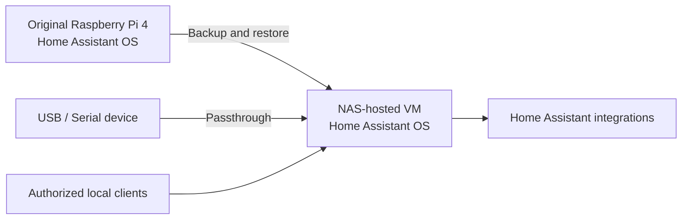

# Home Assistant OS Migration: Raspberry Pi to NAS Virtual Machine

**Infrastructure migration | Virtualization | Backup and recovery | Device passthrough**

> **Portfolio case study.** This repository documents a personal lab migration. Infrastructure identifiers and sensitive configuration details are intentionally omitted.

## Executive summary

Migrated an existing Home Assistant OS installation from a Raspberry Pi 4 running on an SD card to a virtual machine hosted on a UGREEN NASync DXP4800 Plus. The goal was to consolidate always-on services while preserving Home Assistant configuration and connected hardware functionality.

**Result:** Home Assistant became accessible on the NAS-hosted VM after restoring the existing installation; connected devices were subsequently confirmed operational. The migration also provided an opportunity to evaluate virtualization settings and resource usage.

## Scope and environment

| Component | Implementation |
| --- | --- |
| Source | Raspberry Pi 4, Home Assistant OS, SD-card storage |
| Destination | UGREEN NASync DXP4800 Plus, virtual machine |
| VM image | Home Assistant OS QCOW2 disk image |
| Virtual networking | VirtIO network adapter selected during VM creation |
| Hardware integration | USB/serial device passthrough configured |
| Recovery method | Home Assistant backup restore |
| Validation | Web interface, device connectivity, resource monitoring |

## Migration approach

1. Reviewed the source environment and prepared a Home Assistant backup.
2. Created a new VM using a Home Assistant OS QCOW2 image and configured virtual hardware.
3. Booted the VM and confirmed Home Assistant reported it was ready.
4. Restored the previous Home Assistant configuration and checked browser access.
5. Shut down or adjusted the VM as required to configure USB/serial passthrough.
6. Confirmed the connected devices appeared and operated in Home Assistant.
7. Compared memory usage shown by the VM management interface and within Home Assistant.

See [implementation notes](docs/implementation.md) and [validation checklist](docs/validation.md).

## Challenges and troubleshooting

- **Restore appeared stalled:** The restore page remained loading for an extended period. Opening a fresh browser tab eventually showed the restored Home Assistant home screen; this was a UI-access observation, not proof that all restore operations completed at that exact moment.
- **Passthrough settings unavailable while running:** The NAS VM interface did not expose editable USB passthrough options while the VM was running, so VM power state mattered during configuration.
- **Memory display discrepancy:** The NAS VM manager showed approximately 2 GB allocated while Home Assistant itself reported around 1 GB in use out of 2 GB available. These represent different metrics, not necessarily a fault.

## Skills demonstrated

Virtual machine provisioning · Home Assistant OS · backup/restore · hardware passthrough · system troubleshooting · service validation · resource monitoring · operational documentation

## Security and privacy

No backup archives, credentials, network endpoints, device IDs, access tokens, private hostnames, or unredacted configuration files are included. Diagrams use functional labels rather than live addressing. See [security considerations](docs/security.md).

## Architecture

## Next improvements (not claimed as completed)

- Document a repeatable backup and test-restore schedule.
- Establish VM update, patching, and resource-alert routines.
- Measure recovery time and validate restoration using a controlled test.

## Related links

- [Personal website](https://dillondance.com)
- [GitHub profile](https://github.com/dillondance)

*All outcomes describe a personal lab implementation and are not presented as enterprise production experience.*
